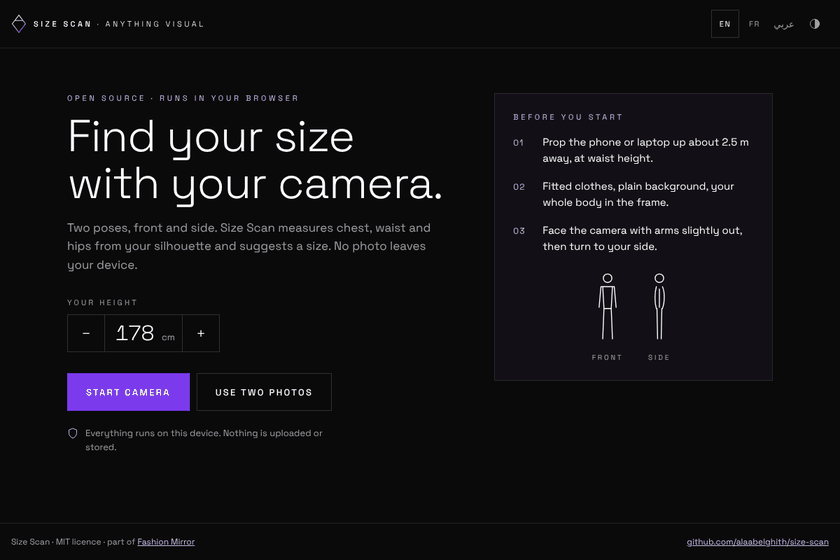

# Size Scan

Find your clothing size with your camera. Stand in front of it, then turn to your side: Size Scan measures your chest, waist and hips from your silhouette and suggests a size for tops, bottoms and dresses. It all runs in the browser. No photo is uploaded or stored.



**Live demo:** https://alaabelghith.github.io/lab/size-scan/ (phone or laptop camera, or two photos)

Size Scan is the sizing step of [Fashion Mirror](https://alaabelghith.github.io/#portfolio/co/fm), an AI try-on kiosk by Anything Visual. The kiosk itself is not open source; this part is.

*The people in these clips are AI-generated test subjects, not real people.*

## How it works

1. **Body points and silhouette.** MediaPipe Pose Landmarker finds 33 body points and a segmentation mask in each camera frame.
2. **Guidance.** Each frame is checked: whole body in frame, feet visible, facing the camera (front), then turned 90° (side). The scan only counts frames that pass, and needs 12 in a row for each pose.
3. **Scale.** Your height and the eye-to-ankle distance in the image give centimetres per pixel. The eyes sit about 7 % of standing height below the top of the head.
4. **Widths and depths.** Three lines are placed between the shoulder and hip points: chest, waist, hips. On the front view the silhouette is measured along each line, **torso only**: arms held away from the body are separated by background and left out, and an arm touching the body is cut at its inner edge, found from the elbow and wrist points. The side view gives the depth at the same three lines.
5. **Circumference.** Each cross-section is treated as an ellipse, width × depth, and its perimeter is Ramanujan's approximation. Every value is the median over the stable frames.
6. **Size.** The circumferences are matched against a size chart (tops by chest, bottoms by waist, dresses by the larger of chest and hips). A value within 2 cm of a boundary also returns the neighbouring size, and a confidence level is shown.

Without a side view, the depth is assumed to be 0.62 × the width, and confidence drops.

## Accuracy

This is a demo-grade estimate. It has been checked on test subjects, not validated with a tape measure on a group of people. Expect a few centimetres of error: loose clothing, posture, camera height and lens distortion all move the numbers. Use it as a starting point, keep a size-exchange policy, and test it against your own customers before relying on it.

The size chart in `src/estimator.js` is a demo chart (S to XL). Replace `SIZE_CHARTS` with your brand's chart.

## Run it locally

```
python -m http.server 8080
```

then open http://localhost:8080. A camera needs `localhost` or `https`. The first load needs internet: MediaPipe (about 9 MB with the model) comes from a CDN and is cached afterwards.

Tests for the measuring maths (Node 18+):

```
node tests/estimator.test.mjs
```

URL options: `?lang=fr` or `?lang=ar`, `?theme=light`, `?h=172` (height), `?gpu=1` (try the GPU delegate; on many devices it returns an empty mask, so CPU is the default).

## Python version

`python/size_estimator.py` is the same method in Python, as it runs in the Fashion Mirror kiosk (MediaPipe 0.10.21 legacy Pose API, NumPy). `python size_estimator.py --selftest` checks the maths without a camera; `--webcam` runs a guided capture. On the same photos the two versions agree within about 1 cm.

## Files

| Path | Contents |
|---|---|
| `index.html` | Page, styles, layout |
| `src/estimator.js` | Measuring maths, pose checks, size chart. No browser APIs |
| `src/app.js` | Camera, MediaPipe, live guidance, two-photo mode, result |
| `src/i18n.js` | English, French, Arabic |
| `python/size_estimator.py` | Python reference implementation |
| `tests/estimator.test.mjs` | Tests (same numbers as the Python self-test) |

## Privacy

Frames are analysed in memory on the device and discarded. The result screen keeps only a silhouette, no photo. Nothing is sent anywhere; the only network requests are for the page itself, the fonts and the MediaPipe files.

## Licence

MIT, see [LICENSE](LICENSE). MediaPipe is Apache-2.0 (Google). Anything Visual, the diamond mark and Fashion Mirror are not covered by the licence.
