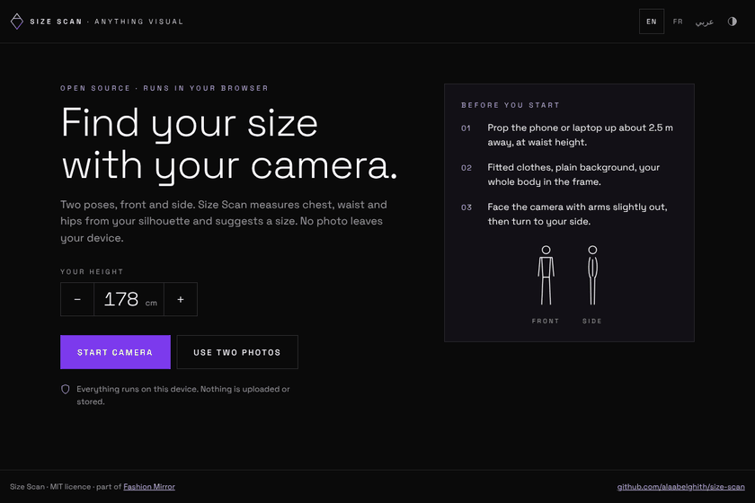

# Size Scan

Find your clothing size with your camera. Stand in front of it, then turn to your side: Size Scan measures your chest, waist and hips from your silhouette and suggests a size for tops, bottoms and dresses. It all runs in the browser. No photo is uploaded or stored.



**Live demo:** https://alaabelghith.github.io/lab/size-scan/ (phone or laptop camera, or two photos)

Size Scan is the sizing step of [Fashion Mirror](https://alaabelghith.github.io/#portfolio/co/fm), an AI try-on kiosk by Anything Visual. The kiosk itself is not open source; this part is.

*The people in these clips are AI-generated test subjects, not real people.*

## How it works

1. **Body points and silhouette.** MediaPipe Pose Landmarker finds 33 body points and a segmentation mask in each camera frame.
2. **Guidance.** Each frame is checked: whole body in frame, feet visible, facing the camera with **arms clearly away from the body** (front), then turned 90° (side). The scan only counts frames that pass, and needs 12 in a row for each pose.
3. **Scale.** Your height and the eye-to-ankle distance in the image give centimetres per pixel (eyes at about 93.6 % of standing height, ankles at about 3.9 %; the ankle point is not the floor).
4. **Widths and depths.** Three bands are measured between the shoulder and hip points, torso only (arms and hands touching the body are cut off at their inner edge, found from the elbow and wrist points plus the hand below the wrist):
   - chest: median width over the chest band,
   - waist: the **narrowest** row between chest and hips (arms and clothing folds can only add width),
   - hips: 30th percentile around the hip line.
   The side view gives the depths over the same bands.
5. **Circumference.** Each cross-section is an ellipse (width × depth, Ramanujan's approximation) times a shape factor (chest 1.06, waist 1.02, hips 1.05), then a calibration factor (default: waist 0.88, hips 0.90, from test scans). Side depths outside plausible depth/width ratios are clamped, and values impossible for the given height are clamped with low confidence. Every value is the median over the stable frames.
6. **Size.** Men's or women's chart: tops by chest (men: Primark ranges, XL = 109–118 cm), bottoms by waist, dresses by the larger of chest and hips, and the **French trouser number** (36–48 men, 32–48 women, number ≈ waist ÷ 2 as at Celio / Kiabi; "48+" above, like mass retail in France and Tunisia).

Without a side view, the depth is assumed from average depth/width ratios, and confidence drops.

## Auto height (fixed camera)

One camera cannot know absolute size, so height is typed in by default. For a **fixed** setup (kiosk, shop mirror, a phone on a tripod) the height can be estimated for everyone:

1. Put a mark on the floor where people stand. Do not move the camera after this.
2. Open the page with `?calibrate=183` (the real height of the person scanning) and do one scan. The page stores centimetres per pixel for this camera.
3. From then on every scan estimates the height from the silhouette (head top to floor) and shows "Height estimated". Standing off the mark by 20–30 cm moves the estimate by roughly 5–10 cm.
4. `?auto=0` forgets the calibration.

## Run it locally

```
python -m http.server 8080
```

then open http://localhost:8080. A camera needs `localhost` or `https`. The first load needs internet: MediaPipe (about 9 MB with the model) comes from a CDN and is cached afterwards.

Tests for the measuring maths (Node 18+):

```
node tests/estimator.test.mjs
```

URL options: `?lang=fr` or `?lang=ar`, `?theme=light`, `?h=172` (height), `?g=women`, `?calibrate=183` / `?auto=0` (auto height), `?gpu=1` (try the GPU delegate; on many devices it returns an empty mask, so CPU is the default).

## Python version

`python/size_estimator.py` is the same method in Python, as it runs in the Fashion Mirror kiosk (MediaPipe 0.10.21 legacy Pose API, NumPy). `python size_estimator.py --selftest` checks the maths without a camera; `--webcam` runs a guided capture. On the same photos the two versions agree within about 1 cm.

## Files

| Path | Contents |
|---|---|
| `index.html` | Page, styles, layout |
| `src/estimator.js` | Measuring maths, pose checks, size chart. No browser APIs |
| `src/app.js` | Camera, MediaPipe, live guidance, two-photo mode, result |
| `src/i18n.js` | English, French, Arabic |
| `python/size_estimator.py` | Python reference implementation |
| `tests/estimator.test.mjs` | Tests (same numbers as the Python self-test) |

## Privacy

Frames are analysed in memory on the device and discarded. The result screen keeps only a silhouette, no photo. Nothing is sent anywhere; the only network requests are for the page itself, the fonts and the MediaPipe files.

## Licence

MIT, see [LICENSE](LICENSE). MediaPipe is Apache-2.0 (Google). Anything Visual, the diamond mark and Fashion Mirror are not covered by the licence.
